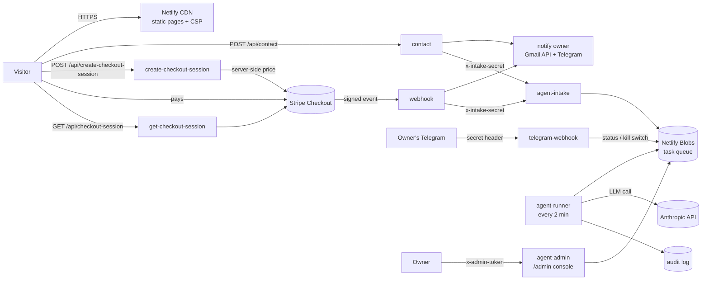

# Secure Serverless Payments

The code behind [bucuriedigital.com](https://bucuriedigital.com), a small cybersecurity advisory business I designed, secured, launched and operate. It is a static site on Netlify with serverless functions for Stripe payments, a contact form, owner alerts by email and Telegram, a Telegram control bot, and a governed AI agent workflow.

This repository is a cleaned-up copy for my portfolio: secrets, deployment state and personal details are removed. The legal pages contain `[TODO-LEGAL: …]` placeholders, and the build refuses to run until they are filled in.

> **How it was built.** I designed, directed, reviewed, tested, deployed and operate this system, using AI coding assistants (Claude and Codex) to write much of the code. Every decision documented here is one I can explain and defend.

## What it does

| Visitor action | What happens |
|---|---|
| Opens a page | Static HTML from Netlify's CDN, served with strict security headers |
| Sends an enquiry | Validated and spam-filtered, then the owner gets an email and a Telegram alert, and three agent tasks are queued |
| Clicks **Book and pay** | A Stripe Checkout session is created with a price fixed on the server |
| Completes payment | Stripe calls a signed webhook, the owner gets an email and a Telegram alert, and four onboarding tasks are queued, exactly once |
| Returns to the site | The thank-you page asks Stripe whether the payment actually succeeded before saying so |
| Owner sends `/status`, `/kill` or `/resume confirm` to the bot | Telegram calls an authenticated webhook that reports agent state or flips the kill switch |

## Architecture



All functions live in [`netlify/functions/`](netlify/functions). Files starting with `_` are shared modules, not endpoints.

## Security controls

| Threat | Control | Where |
|---|---|---|
| Buyer changes the price in the browser | The browser sends only a service ID; the amount comes from a server-side catalogue. Tested: sending `amount: 1` still charges the catalogue price. | [`create-checkout-session.js`](netlify/functions/create-checkout-session.js), [`_shared.js`](netlify/functions/_shared.js) |
| Forged "payment succeeded" events | Every webhook is verified against Stripe's signature; unsigned or wrongly signed requests get `400` | [`webhook.js`](netlify/functions/webhook.js) |
| Stripe retries cause double fulfilment | Each paid checkout session is processed once (session marker), and the task intake ignores task IDs it has already seen | [`webhook.js`](netlify/functions/webhook.js), [`agent-intake.js`](netlify/functions/agent-intake.js) |
| "Thank you" shown for an unpaid order | The success page checks the session's payment status with Stripe and shows paid, unpaid, or unknown | [`script.js`](script.js), [`get-checkout-session.js`](netlify/functions/get-checkout-session.js) |
| Cross-site scripting, clickjacking | Strict Content-Security-Policy with `script-src 'self'` (no inline scripts at all), `frame-ancestors 'none'`, `X-Frame-Options: DENY`, HSTS, `nosniff`, Permissions-Policy | [`netlify.toml`](netlify.toml), [`public/_headers`](public/_headers) |
| Contact-form spam and cost abuse | Hidden honeypot field, a JavaScript-set token, a required acknowledgement, and a limit of 5 enquiries per visitor per hour. The rate limit stores a SHA-256 hash of the IP, never the IP itself, and fails open so genuine leads aren't lost. | [`contact.js`](netlify/functions/contact.js) |
| Admin and intake endpoints brute-forced | Shared-secret headers compared with `crypto.timingSafeEqual`; admin tokens must be at least 16 characters | [`agent-admin.js`](netlify/functions/agent-admin.js), [`agent-intake.js`](netlify/functions/agent-intake.js) |
| Secrets in code or logs | All keys come from encrypted environment variables. A logging helper redacts known secret fields. The Gmail setup script writes the refresh token to a git-ignored file instead of printing it. | [`_log.js`](netlify/functions/_log.js), [`scripts/gmail-auth.mjs`](scripts/gmail-auth.mjs) |
| Someone else controls the agents through the Telegram bot | Webhook requires Telegram's secret header (`timingSafeEqual`, 401 otherwise); only the owner's chat and user ID are obeyed, and strangers get no reply; commands older than 5 minutes are ignored; restarting needs `/resume confirm` | [`telegram-webhook.js`](netlify/functions/telegram-webhook.js) |
| Over-privileged integrations | Gmail OAuth requests only the `gmail.send` scope. The AI key is workspace-scoped, not organisation-wide. | [`_gmail.js`](netlify/functions/_gmail.js) |
| Publishing a site with unfinished legal pages | The `check:legal` step fails the build while any `[TODO-LEGAL: …]` placeholder remains | [`scripts/check-placeholders.mjs`](scripts/check-placeholders.mjs) |

### AI agent guardrails

Seven role agents (Sales, CEO, Operations, Cybersecurity Consultant, Finance, Marketing, Research) process queued tasks. Because their output can reach customers, they run inside hard limits that apply in every mode:

- **Modes:** `off`, `dry-run` (the default if unset or misspelled, so a config mistake fails safe), `review` (a human approves each email), or `live`.
- **Recipient lock:** an agent may only email the person tied to the originating enquiry or order.
- **Content scan** blocks security guarantees, unverified breach claims, false certification claims, credential or remote-access requests, prices outside the catalogue, and anything presented as legal or tax advice. Blocked drafts go to a human.
- **Rate limits:** at most 15 emails an hour, and one email per recipient per 6 hours.
- **Kill switch** in the admin console stops all processing.
- **Retries with leases:** a task gets 3 attempts; a crashed run's lease expires after 5 minutes so the task is retried, not lost.
- **Audit log** of every run, decision and send.

See [`_guardrails.js`](netlify/functions/_guardrails.js) and [`agent-runner.js`](netlify/functions/agent-runner.js).

### Telegram alerts and control

Email is easy to miss, so every new enquiry and payment is also pushed to the owner's phone through a Telegram bot, and the same bot works as a remote control:

| Command | Effect |
|---|---|
| `/status` | Agent mode, kill switch, tasks waiting, approvals pending, last activity |
| `/kill` | Turns the kill switch on immediately |
| `/resume` | Asks for confirmation; `/resume confirm` turns the kill switch off |

Design decisions:

- **Webhook, not polling.** Telegram calls the site, so nothing runs on a schedule, and a webhook also stops any other program from reading the bot's messages with `getUpdates`.
- **Three checks before acting:** Telegram's secret header, the owner's chat ID *and* user ID, and a 5-minute age limit, so a delayed or replayed delivery can't flip the kill switch later.
- **Asymmetric friction:** stopping is one tap; starting again needs an explicit confirmation.
- **Always reply 200 after authentication,** otherwise Telegram keeps redelivering the same update.
- **Plain-text messages only.** Visitor input from the contact form can't inject formatting or disguised links into the alert.
- **One source of truth.** The admin console and the bot both read state through [`_agent-status.js`](netlify/functions/_agent-status.js), so they can't disagree.
- **Alerts never block the business flow.** Email and Telegram are sent in parallel, and a failure in either is logged without losing the enquiry or making Stripe retry.

Setup: [`scripts/telegram-setup.mjs`](scripts/telegram-setup.mjs) finds the owner's chat ID, then `--webhook` registers the webhook with its secret and the command menu, without ever printing the token.

## Testing done

Tests run by hand against a local server and the live site, recorded in [docs/case-study-payments.md](docs/case-study-payments.md):

- **Payments in Stripe test mode:** all five prices, price tampering, a successful card, a declined card, cancellation, a real paid session replayed through the webhook, and duplicate delivery.
- **Webhook edge cases with signed test events:** delayed bank payment (pending, then succeeded, or failed), expired checkout, forged signature, replayed event.
- **Contact form:** valid enquiry, honeypot, invalid email, rate limit (5 accepted, 6th refused), and a live end-to-end check that the owner email is delivered.
- **Agents in production:** dry-run processing confirmed in the function logs.
- **Telegram bot:** 15 local cases with faked updates (missing and wrong secret, a stranger sending `/kill`, a 10-minute-old `/kill`, every command, `/resume` without confirmation, the admin console seeing the same state), then live: unauthenticated requests get `401`, and `/status`, `/kill` and `/resume confirm` work from a phone.

There is no automated test suite in this repository yet; that's the first item under "Next steps".

## Running locally

```bash
npm install
cp .env.example .env.local    # fill in test keys only (sk_test_..., never sk_live_)
npm run check                 # HTML lint, syntax checks, legal-placeholder check
npm run build
PORT=8080 node docker-server.mjs
```

`docker-server.mjs` serves `dist/` and routes `/api/*` to the same function handlers Netlify runs. The site and `/api/health` work without any keys; payments, email and agents each switch on when their variables are set. See [`.env.example`](.env.example) for every setting.

## Deploying

The project deploys to Netlify. [`netlify.toml`](netlify.toml) sets the build, the function directory, the agent runner's schedule (`*/2 * * * *`), the redirects and the security headers. Environment variables must be added in Netlify, with every key marked as secret. **Netlify only applies changed variables to a new deploy.**

## Lessons from operating it

- **A scheduled function crashed every 2 minutes for weeks without anyone noticing.** It imported a helper whose runtime file wasn't bundled. Moving the schedule into `netlify.toml` fixed it, and structured logging is what found it. Silent failure is the default; logs have to be designed in.
- **Test the unhappy paths of payments.** Duplicate webhook delivery and the misleading thank-you page were both found by deliberately doing the wrong thing.
- **A bot token can be in use somewhere you forgot.** During setup the bot received no messages at all, even though Telegram showed them as read. Another program, most likely left over from an earlier experiment, was still polling with the token and taking every update. Revoking the token cut it off, and switching to a webhook means it can't silently happen again.
- **Credential hygiene in practice:** two OAuth client secrets were exposed during setup and rotated immediately. Write-up: [docs/incident-credential-rotation.md](docs/incident-credential-rotation.md).

## Next steps

- An automated test suite: webhook signature and idempotency, guardrail patterns, rate limiting.
- Per-user admin authentication with MFA instead of a single shared token.
- Remove `'unsafe-inline'` from `style-src`.
- Secret scanning and dependency checks in CI.

## Licence

[MIT](LICENSE)
